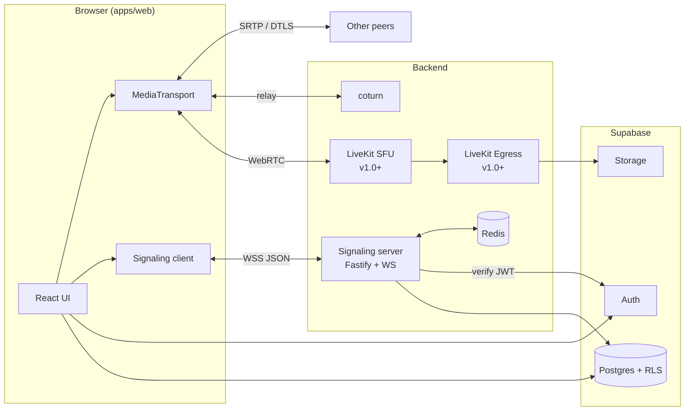
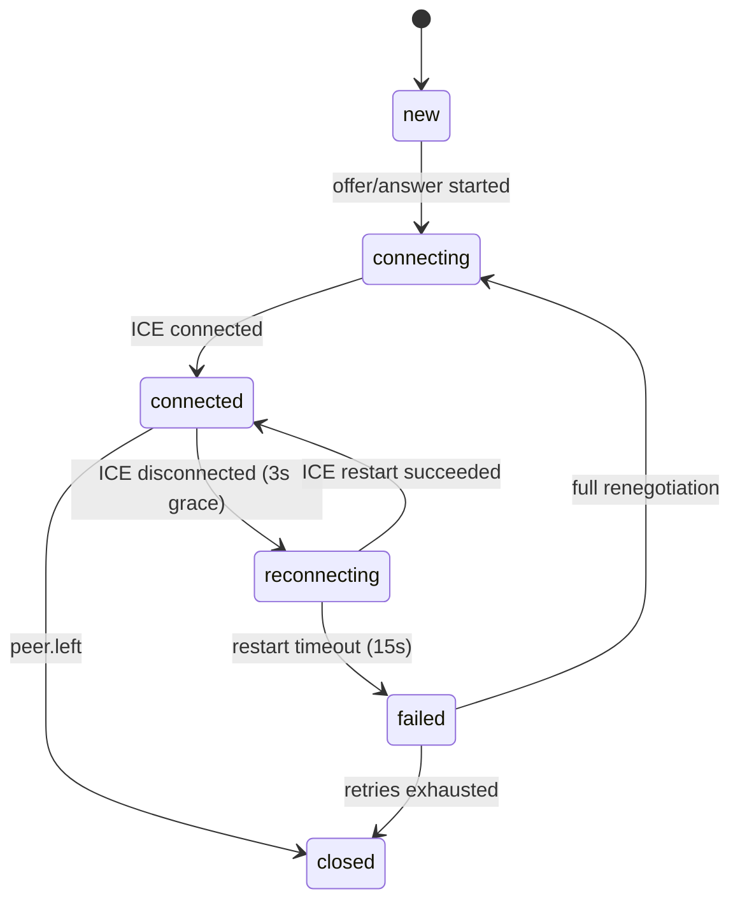
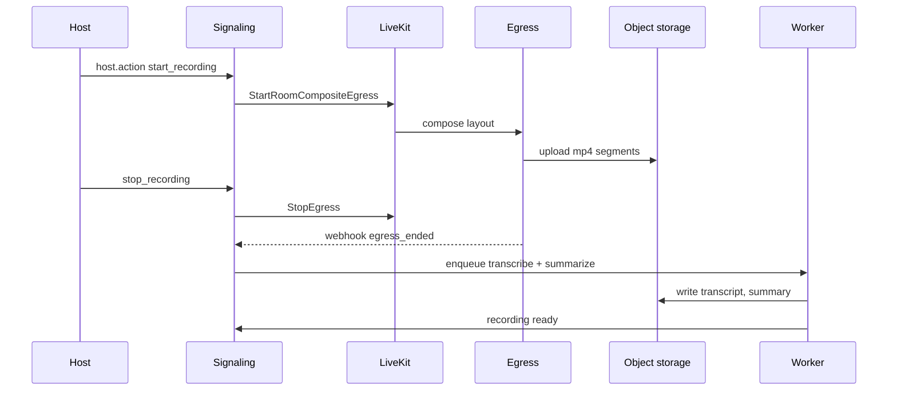

# MeetIT Architecture

Status: living document. Decisions that change get an ADR in `docs/adr/`.

---

## 1. Goals and non-goals

### Goals

1. **Time to first frame under 5 seconds** from clicking a link to seeing and hearing others.
2. **Graceful on bad networks.** Packet loss, jitter, and network switches degrade quality, not the call.
3. **Swap-able media layer.** Ship on mesh P2P, migrate to an SFU without rewriting the UI.
4. **Small operational footprint.** One signaling service, one TURN service, one database.
5. **Secure by default.** Authenticated signaling, short-lived TURN credentials, room-level authorization.

### Non-goals (v1)

- Building our own SFU. We adopt LiveKit.
- Native mobile apps (PWA first).
- Telephony/PSTN (later phase).

---

## 2. System context



### Component responsibilities

| Component           | Owns                                                                                  | Does not own                                  |
| ------------------- | ------------------------------------------------------------------------------------- | --------------------------------------------- |
| `apps/web`          | UI, device management, local state, transport orchestration                           | Authorization decisions                       |
| `apps/signaling`    | Room membership, message relay, host actions, TURN credential issuance, rate limiting | Media bytes                                   |
| `packages/protocol` | Message schemas shared by client and server                                           | Business logic                                |
| `packages/media`    | `MediaTransport` interface and implementations                                        | UI                                            |
| coturn              | NAT traversal relay                                                                   | Anything else                                 |
| LiveKit (v1.0+)     | Media routing, simulcast, recording egress                                            | Room policy (signaling stays source of truth) |
| Supabase            | Identity, durable data, file storage                                                  | Realtime call state                           |

---

## 3. Repository and package boundaries

```
packages/protocol   -> no deps except zod
packages/media      -> depends on protocol
apps/signaling      -> depends on protocol
apps/web            -> depends on protocol, media, ui
```

Rules:

- `apps/web` never imports from `apps/signaling` and vice versa. Shared contracts live in `packages/protocol` only.
- UI components never touch `RTCPeerConnection`. They consume the `MediaTransport` event stream through hooks.

---

## 4. Media transport abstraction

The single most important seam in the system.

```ts
// packages/media/src/transport.ts
export type TrackSource = 'camera' | 'microphone' | 'screen' | 'screen_audio';

export interface ConnectOptions {
  roomId: string;
  selfId: string;
  iceServers: RTCIceServer[];
  signaling: SignalingChannel;
}

export interface RemoteTrackEvent {
  peerId: string;
  source: TrackSource;
  track: MediaStreamTrack;
}

export interface TransportEvents {
  trackSubscribed: (e: RemoteTrackEvent) => void;
  trackUnsubscribed: (e: { peerId: string; source: TrackSource }) => void;
  connectionStateChanged: (e: { peerId: string; state: ConnState }) => void;
  activeSpeakers: (e: { peerIds: string[] }) => void;
  qualityChanged: (e: {
    peerId: string;
    quality: 'excellent' | 'good' | 'poor' | 'lost';
  }) => void;
  error: (e: TransportError) => void;
}

export type ConnState =
  'new' | 'connecting' | 'connected' | 'reconnecting' | 'failed' | 'closed';

export interface MediaTransport {
  connect(opts: ConnectOptions): Promise<void>;
  disconnect(): Promise<void>;

  publish(
    track: MediaStreamTrack,
    source: TrackSource,
    opts?: PublishOptions,
  ): Promise<void>;
  unpublish(source: TrackSource): Promise<void>;
  replaceTrack(source: TrackSource, track: MediaStreamTrack): Promise<void>;

  // Receiver-side quality control. No-op on mesh, real on SFU.
  setSubscriptionQuality(
    peerId: string,
    q: 'high' | 'medium' | 'low' | 'off',
  ): void;

  getStats(): Promise<TransportStats>;
  on<E extends keyof TransportEvents>(
    event: E,
    cb: TransportEvents[E],
  ): () => void;
}
```

Implementations:

- `MeshTransport` (v0.1 to v0.3): one `RTCPeerConnection` per remote peer, perfect negotiation.
- `LiveKitTransport` (v1.0): wraps `livekit-client`, maps its events onto `TransportEvents`.
- `FakeTransport`: in-memory implementation for unit and UI tests.

Selection happens at room join via `room.transport` returned by signaling (`mesh` or `sfu`), so a room can be promoted from mesh to SFU when participant count crosses a threshold.

---

## 5. Signaling protocol

Transport: secure WebSocket, JSON text frames, one message per frame. Every message is validated with Zod on both ends. Unknown message types are dropped and counted.

### Envelope

```ts
// packages/protocol/src/envelope.ts
import { z } from 'zod';

export const Envelope = z.object({
  v: z.literal(1),
  id: z.string().uuid().optional(), // client-generated, for acks
  ts: z.number().optional(),
  type: z.string(),
  payload: z.unknown(),
});
```

### Client to server

| Type            | Payload                                          | Notes                                                                  |
| --------------- | ------------------------------------------------ | ---------------------------------------------------------------------- |
| `join`          | `{ roomCode, displayName, token, capabilities }` | `token` is a Supabase JWT or signed guest token                        |
| `leave`         | `{}`                                             | Graceful exit                                                          |
| `signal.offer`  | `{ to, sdp }`                                    | Mesh only                                                              |
| `signal.answer` | `{ to, sdp }`                                    | Mesh only                                                              |
| `signal.ice`    | `{ to, candidate }`                              | Trickle ICE                                                            |
| `state.update`  | `{ audio, video, screen, handRaised }`           | Broadcast to room                                                      |
| `chat.send`     | `{ text, to? }`                                  | `to` omitted means everyone                                            |
| `reaction.send` | `{ emoji }`                                      | Rate limited                                                           |
| `host.action`   | `{ action, target? }`                            | `mute`, `mute_all`, `remove`, `lock`, `unlock`, `admit`, `deny`, `end` |
| `ping`          | `{}`                                             | Keepalive, 15s                                                         |

### Server to client

| Type            | Payload                                                         |
| --------------- | --------------------------------------------------------------- |
| `joined`        | `{ selfId, role, peers[], iceServers[], transport, roomState }` |
| `waiting`       | `{ position }` (waiting room)                                   |
| `peer.joined`   | `{ peer }`                                                      |
| `peer.left`     | `{ peerId, reason }`                                            |
| `signal.*`      | relayed as sent, with `from`                                    |
| `state.updated` | `{ peerId, state }`                                             |
| `chat.message`  | `{ id, from, text, ts }`                                        |
| `host.event`    | `{ event, by, target? }`                                        |
| `room.updated`  | `{ locked, hostId, ... }`                                       |
| `error`         | `{ code, message }`                                             |
| `pong`          | `{}`                                                            |

### Error codes

`ROOM_NOT_FOUND`, `ROOM_LOCKED`, `ROOM_FULL`, `NOT_ADMITTED`, `UNAUTHORIZED`, `FORBIDDEN`, `RATE_LIMITED`, `INVALID_MESSAGE`, `PROTOCOL_VERSION`.

### Delivery guarantees

- Signaling relay is at-most-once per connection. Reliability comes from reconnect plus state resync on `joined`.
- State is last-write-wins per peer. The server is the source of truth for `roomState`.
- Chat has server-assigned IDs and ordering. Missed messages are backfilled on reconnect via `since` cursor.

---

## 6. WebRTC negotiation (mesh)

We use the **perfect negotiation** pattern to avoid glare.

- Peer with the lexicographically lower `peerId` is **impolite**; the other is **polite**.
- Polite peers roll back on collision. Impolite peers ignore colliding offers.
- All negotiation runs from `onnegotiationneeded`.
- ICE is trickled. Candidates received before the remote description is set are queued.

### Connection lifecycle



### Recovery ladder

1. **0 to 3 s disconnected:** do nothing, ICE often self-heals.
2. **3 s:** ICE restart (`restartIce()` then new offer with `iceRestart: true`).
3. **15 s:** tear down the `RTCPeerConnection` and renegotiate from scratch.
4. **Signaling socket lost:** exponential backoff reconnect with jitter, then rejoin with the same `selfId` to reclaim the slot (30 s grace on the server).
5. **Full failure:** surface a clear "Reconnect" action in the UI.

---

## 7. Media pipeline and quality

### Capture defaults

- Video: 720p at 30 fps ideal, `facingMode: 'user'`, constrained by device.
- Audio: `echoCancellation`, `noiseSuppression`, `autoGainControl` on; Opus with DTX and in-band FEC enabled.

### Adaptation (mesh)

- Use `RTCRtpSender.setParameters()` to cap `maxBitrate` by participant count:

| Participants | Per-stream video cap                       |
| ------------ | ------------------------------------------ |
| 2            | 1.5 Mbps                                   |
| 3 to 4       | 800 kbps                                   |
| 5+           | Force SFU, or 300 kbps with audio priority |

- `degradationPreference`: `maintain-framerate` for camera, `maintain-resolution` for screen share.
- On poor `getStats()` signals (loss above 8% or RTT above 400 ms for 5 s), step down: reduce resolution, then fps, then drop video and keep audio.

### Adaptation (SFU)

- Publishers send simulcast (3 layers). Subscribers request layers per tile size and visibility.
- Dynacast pauses layers nobody consumes.
- Off-screen tiles in large grids are unsubscribed from video entirely.

### Modes

- **Normal**, **Data saver** (max 360p, 15 fps), **Audio only** (video off, UI avatars).

### Active speaker

- v0.2: `AudioContext` + `AnalyserNode` on each remote stream, RMS above threshold with 300 ms hysteresis.
- v1.0: use LiveKit's server-side active speaker events.

---

## 8. Data model

Postgres on Supabase. Realtime call state lives in Redis and memory, not Postgres.

```sql
-- supabase/migrations/0001_init.sql
create extension if not exists "pgcrypto";

create table profiles (
  id uuid primary key references auth.users on delete cascade,
  display_name text not null,
  avatar_url text,
  created_at timestamptz not null default now()
);

create type room_kind as enum ('instant', 'scheduled', 'personal');

create table rooms (
  id uuid primary key default gen_random_uuid(),
  code text not null unique check (code ~ '^[a-z]{3}-[a-z]{4}-[a-z]{3}$'),
  owner_id uuid references profiles(id) on delete set null,
  kind room_kind not null default 'instant',
  title text,
  settings jsonb not null default '{
    "waiting_room": false,
    "locked": false,
    "allow_guests": true,
    "chat_enabled": true,
    "screen_share": "everyone",
    "max_participants": 50
  }',
  created_at timestamptz not null default now(),
  expires_at timestamptz
);
create index on rooms (owner_id);

create table meetings (            -- one row per live session of a room
  id uuid primary key default gen_random_uuid(),
  room_id uuid not null references rooms(id) on delete cascade,
  started_at timestamptz not null default now(),
  ended_at timestamptz,
  peak_participants int not null default 0,
  transport text not null default 'mesh' check (transport in ('mesh','sfu'))
);
create index on meetings (room_id, started_at desc);

create table participants (
  id uuid primary key default gen_random_uuid(),
  meeting_id uuid not null references meetings(id) on delete cascade,
  user_id uuid references profiles(id) on delete set null,
  display_name text not null,
  role text not null default 'attendee' check (role in ('host','cohost','attendee','guest')),
  joined_at timestamptz not null default now(),
  left_at timestamptz
);
create index on participants (meeting_id);

create table scheduled_meetings (
  id uuid primary key default gen_random_uuid(),
  room_id uuid not null references rooms(id) on delete cascade,
  starts_at timestamptz not null,
  duration_minutes int not null default 30,
  rrule text,                       -- RFC 5545 recurrence
  invitees jsonb not null default '[]',
  created_by uuid not null references profiles(id)
);

create table chat_messages (
  id bigint generated always as identity primary key,
  meeting_id uuid not null references meetings(id) on delete cascade,
  sender_name text not null,
  sender_id uuid references profiles(id) on delete set null,
  body text not null check (char_length(body) <= 4000),
  created_at timestamptz not null default now()
);
create index on chat_messages (meeting_id, id);

create table recordings (
  id uuid primary key default gen_random_uuid(),
  meeting_id uuid not null references meetings(id) on delete cascade,
  storage_path text not null,
  duration_seconds int,
  status text not null default 'processing' check (status in ('processing','ready','failed')),
  created_at timestamptz not null default now()
);

-- RLS
alter table profiles enable row level security;
alter table rooms enable row level security;
alter table meetings enable row level security;
alter table participants enable row level security;
alter table scheduled_meetings enable row level security;
alter table chat_messages enable row level security;
alter table recordings enable row level security;

create policy "own profile" on profiles for all using (auth.uid() = id);
create policy "owner manages rooms" on rooms for all using (auth.uid() = owner_id);
create policy "anyone resolves room by code" on rooms for select using (true);
```

Further policies for meetings, participants, chat, and recordings follow the rule: **visible to the room owner and to users who appear in `participants` for that meeting.** Writes to `meetings`, `participants`, and `chat_messages` go through the signaling server using the service role, never directly from the client.

### Room codes

- Format `xxx-xxxx-xxx` from the alphabet `abcdefghjkmnpqrstuvwxyz` (no ambiguous characters), roughly 36 bits of entropy.
- Generated server-side with `crypto.randomInt`. Collisions retry.
- Instant rooms expire after 24 h of inactivity. Personal rooms are permanent.
- Brute-force protection: rate limit join attempts per IP and per code.

---

## 9. Authentication and authorization

### Identities

- **Registered user:** Supabase Auth (email, magic link, Google). Client sends the Supabase JWT in `join.token`.
- **Guest:** client calls `POST /guest-token` with room code and display name. The server returns an HMAC-signed token (TTL 12 h) bound to that room.

### Roles

`host` > `cohost` > `attendee` > `guest`. Role is determined at join and stored in server-side room state. The client never asserts its own role.

### Authorization matrix (excerpt)

| Action                  | host   | cohost | attendee | guest  |
| ----------------------- | ------ | ------ | -------- | ------ |
| Mute others             | yes    | yes    | no       | no     |
| Remove participant      | yes    | yes    | no       | no     |
| Lock room               | yes    | yes    | no       | no     |
| Admit from waiting room | yes    | yes    | no       | no     |
| End meeting for all     | yes    | no     | no       | no     |
| Screen share            | policy | policy | policy   | policy |
| Chat                    | policy | policy | policy   | policy |

"policy" means governed by `rooms.settings`.

### WebSocket auth

- Token is sent in the first `join` frame, not in the URL (URLs end up in logs).
- Server validates within 5 s or closes with code 4401.
- `Origin` is checked against `ALLOWED_ORIGINS`.

---

## 10. NAT traversal and TURN

- STUN: public Google STUN for dev, self-hosted coturn for production.
- TURN: coturn with `use-auth-secret`. The signaling server issues **time-limited credentials** per join:

```ts
import { createHmac } from 'node:crypto';

export function turnCredentials(userId: string, secret: string, ttl = 3600) {
  const username = `${Math.floor(Date.now() / 1000) + ttl}:${userId}`;
  const credential = createHmac('sha1', secret)
    .update(username)
    .digest('base64');
  return { username, credential };
}
```

- Offer UDP 3478, TCP 3478, and TLS 443/5349 (many corporate networks only allow 443).
- Expect 15 to 20% of sessions to need relay. Budget bandwidth accordingly and monitor relay ratio via `getStats()` (`candidateType === 'relay'`).
- Lock down coturn: deny private IP ranges (`denied-peer-ip`), set `total-quota` and `user-quota`, enable `no-multicast-peers`.

---

## 11. Scaling and high availability

### Signaling

- Stateless except for in-memory room objects. Rooms are sharded by `hash(roomCode) % N` using consistent hashing at the load balancer, so one room lives on one node.
- Redis pub/sub provides cross-node fan-out for host actions and room metadata, plus presence TTL keys (`presence:{room}:{peer}`).
- A node crash drops its sockets. Clients reconnect with the same `selfId`, and the new node rebuilds room state from Redis.

### Targets

| Metric                              | v0.x         | v1.0                           |
| ----------------------------------- | ------------ | ------------------------------ |
| Concurrent rooms per signaling node | 2,000        | 10,000                         |
| Participants per room               | 4 (mesh)     | 100 (SFU), 500+ with cascading |
| Signaling p99 relay latency         | under 100 ms | under 50 ms                    |

### SFU

- LiveKit self-hosted on dedicated nodes with host networking, UDP port range open, Redis for node discovery.
- Cascading across regions in later phases to keep RTT low for distributed meetings.

---

## 12. Recording and post-processing (v1.0+)



- Consent: all participants see a persistent recording indicator and a one-time audible/visual notice. Joining while recording requires acknowledgement.
- Retention: configurable per workspace, default 30 days, hard delete on request.

---

## 13. Client architecture

### State

- **Zustand** stores, split by concern: `useRoomStore`, `usePeersStore`, `useDevicesStore`, `useChatStore`, `useUIStore`.
- Transport events update stores through a single adapter module. Components subscribe to narrow selectors to avoid re-render storms.

### Rendering

- Video tiles use `<video>` with `srcObject`, `playsInline`, and `muted` for the local tile.
- Grid layout computed from participant count and viewport with a pure `computeLayout()` function (unit tested).
- Virtualize tiles beyond 25 participants. Only visible tiles subscribe to video.

### Performance budget

- JS bundle for the lobby route: under 150 KB gzipped. Call route lazy-loads transport code.
- Main thread: no work over 50 ms during a call. Heavy tasks (background blur, noise suppression) run in Workers or `AudioWorklet`.

### Accessibility

- Full keyboard control with documented shortcuts (`M` mute, `V` video, `C` chat, `H` hand, `Esc` close panels).
- ARIA live regions for join/leave and chat. Captions on by default option.
- Respect `prefers-reduced-motion` and `prefers-color-scheme`.

---

## 14. Observability

### Client telemetry (sampled, privacy-respecting)

Every 5 s during a call, collect from `getStats()`: RTT, jitter, packet loss, bitrate, frame rate, resolution, candidate type, quality-limitation reason. Batch and send to `POST /telemetry` at the end of the call and on `visibilitychange`.

### Server

- Structured JSON logs (pino) with `roomId`, `peerId`, `traceId`. No SDP or ICE candidates in logs (they leak IPs).
- Metrics (Prometheus): active rooms, active sockets, join success rate, join latency, relay ratio, reconnects per call, message rates, rate-limit hits.
- Traces (OpenTelemetry) across join flow: HTTP token fetch, WS upgrade, auth, room load, `joined` sent.
- Errors: Sentry on web and signaling.

### Core SLOs

| SLO                                 | Target              |
| ----------------------------------- | ------------------- |
| Join success rate                   | 99.5%               |
| Time to first remote frame (p75)    | under 5 s           |
| Calls with a reconnect that recover | 95%                 |
| Audio MOS-equivalent good or better | 90% of call minutes |

---

## 15. Security and threat model

| Threat                    | Mitigation                                                                                                       |
| ------------------------- | ---------------------------------------------------------------------------------------------------------------- |
| Room code guessing        | 36-bit codes, per-IP and per-code rate limits, optional passcode, waiting room                                   |
| Unauthorized host actions | Server-side role checks only; client role claims ignored                                                         |
| Signaling flooding        | Per-connection token bucket (e.g. 30 msg/s burst 60), max frame size 64 KB, auto-disconnect on repeat violations |
| Impersonation             | Display names are labels; identity badge shows verified account vs guest                                         |
| IP leakage via ICE        | Offer "relay only" privacy mode; mDNS candidates for host candidates                                             |
| TURN abuse                | Short-lived HMAC credentials, per-user quotas, private-range denylist                                            |
| XSS via chat              | Plain-text only, render with React escaping, linkify with `rel="noopener noreferrer"`                            |
| Zoom-bombing              | Lock, waiting room, remove-and-block, mute-all, disable guest screen share                                       |
| Recording consent         | Visible indicator, join-time notice, audit log                                                                   |
| CSRF / WS hijack          | Origin allow-list, token in first frame                                                                          |
| Supply chain              | Lockfile, Dependabot, `pnpm audit` in CI, pinned CDN-free build                                                  |

### Transport security

- WSS only in production. HSTS on all domains.
- WebRTC media is DTLS-SRTP encrypted hop by hop. With an SFU, the SFU can see media.
- **E2EE (later phase):** WebRTC Encoded Transform (insertable streams) with SFrame-style framing; keys exchanged over MLS or a simple authenticated ECDH group scheme; key rotation on join and leave.

### CSP baseline

```
default-src 'self';
connect-src 'self' wss://signal.example.com https://*.supabase.co wss://*.livekit.cloud;
img-src 'self' data: blob:;
media-src 'self' blob: mediastream:;
script-src 'self';
style-src 'self' 'unsafe-inline';
frame-ancestors 'none';
```

---

## 16. Testing strategy

| Level          | Tooling                                                                                                  | Scope                                                                    |
| -------------- | -------------------------------------------------------------------------------------------------------- | ------------------------------------------------------------------------ |
| Unit           | Vitest                                                                                                   | Protocol schemas, layout, state reducers, backoff, credential generation |
| Component      | Vitest + Testing Library                                                                                 | Controls, lobby, tile grid with `FakeTransport`                          |
| Integration    | Vitest + real Fastify in-process                                                                         | Join, relay, host actions, reconnect and slot reclaim                    |
| E2E multi-peer | Playwright, 2 to 4 browser contexts, `--use-fake-device-for-media-stream --use-fake-ui-for-media-stream` | Real calls: connect, mute, share, chat, leave                            |
| Network chaos  | `tc netem` / Toxiproxy in CI containers                                                                  | Loss, latency, bandwidth caps, forced ICE failure                        |
| Load           | k6 (WS) + synthetic headless clients                                                                     | Signaling capacity; LiveKit loadtester for SFU                           |
| Cross-browser  | Playwright (Chromium, Firefox, WebKit) + real-device smoke on iOS Safari and Android Chrome              | Compatibility matrix                                                     |

Assertions in E2E use `getStats()` to verify that bytes are actually flowing, not just that the UI says "connected".

---

## 17. Deployment

```
Vercel           apps/web                      (preview per PR)
Fly.io           apps/signaling  (2+ machines, multi-region later)
Fly.io / VPS     coturn          (dedicated IP, UDP + TLS 443)
Upstash/Fly      Redis
Supabase         Auth, Postgres, Storage
LiveKit          Cloud (start) -> self-hosted (cost)
```

- CI: GitHub Actions. Pipeline: install, lint, typecheck, unit, build, e2e, deploy.
- Migrations applied via Supabase CLI on merge to `main`; destructive migrations require a two-step expand/contract rollout.
- Feature flags (simple table + env) gate risky features like SFU promotion and E2EE.

---

## 18. Browser support

| Browser                       | Support                                                                                   |
| ----------------------------- | ----------------------------------------------------------------------------------------- |
| Chrome / Edge (last 2 majors) | Full                                                                                      |
| Firefox (last 2 majors)       | Full, no background blur initially                                                        |
| Safari 16.4+ (macOS, iOS)     | Full with known workarounds (autoplay, codec preference, screen share on iOS unsupported) |
| Android Chrome                | Full                                                                                      |
| Others                        | Best effort                                                                               |

Codec policy: VP8 baseline for universal compatibility, H.264 preferred on Safari and mobile for hardware encode, AV1 and VP9 SVC evaluated with the SFU.

---

## 19. Architecture decision records (planned)

| ADR  | Title                                            | Status   |
| ---- | ------------------------------------------------ | -------- |
| 0001 | License (MIT vs AGPL open-core)                  | Open     |
| 0002 | Mesh first behind `MediaTransport`, SFU later    | Accepted |
| 0003 | LiveKit over mediasoup                           | Proposed |
| 0004 | Signaling over WebSocket (not Supabase Realtime) | Proposed |
| 0005 | Perfect negotiation for mesh                     | Accepted |
| 0006 | Redis for presence and cross-node fan-out        | Proposed |
| 0007 | Guest identity model                             | Proposed |
| 0008 | E2EE scheme (SFrame + MLS vs simple ECDH)        | Open     |

---

## 20. Open questions

1. Is signaling on Supabase Realtime acceptable for the earliest prototype to skip running a server, accepting rework later?
2. Per-room SFU promotion mid-call (seamless) or only at room start?
3. Do we store chat permanently or only for the meeting duration by default?
4. Region strategy: single region first, or two from the start?
